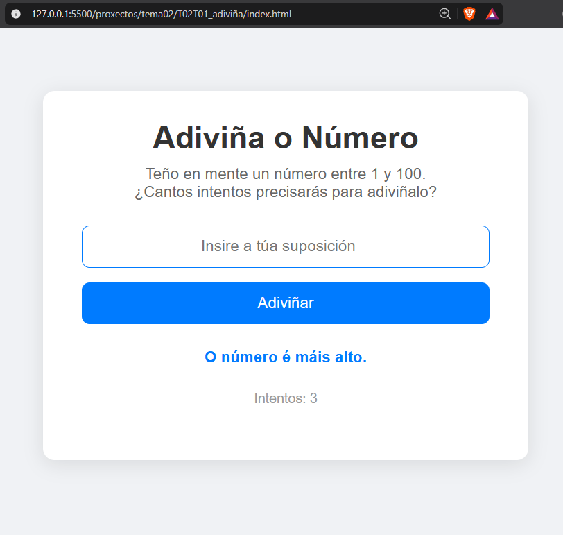

# T02T01 · Adiviña o número

| Módulo | Tema | Ficheiros | Conceptos |
|---|---|---|---|
| MP0612 · DWEC | Tema 2 · Introdución a JavaScript | `index.html` · `estilos.css` · `t02t01.js` | `defer`, `const`/`let`, `Number()`, `Math.random()`, `if/else if/else`, DOM |



---

## 1. Introdución e obxectivos

### 1.1. Caso práctico

Construír unha pequena aplicación web interactiva chamada **«Adiviña o número»**. O navegador xera un número enteiro aleatorio entre 1 e 100 e a persoa usuaria introduce sucesivas propostas ata acertalo. Cada intento produce unha mensaxe que indica se o número agochado é máis alto ou máis baixo.

A solución separa responsabilidades en tres ficheiros: `index.html` (estrutura, conecta a folla de estilos e o script), `estilos.css` (presentación) e `t02t01.js` (estado do xogo, validación, comparacións e actualización do DOM).

### 1.2. Resultado esperado

Ao abrir `index.html` debe verse un panel centrado cun título, unha explicación, un campo numérico e o botón **«Adiviñar»**. Unha entrada válida incrementa o contador e informa da orientación da seguinte tentativa. Ao acertar, móstrase unha mensaxe de parabéns, desactívase o campo e escóndese o botón.

### 1.3. Resultados de aprendizaxe

- Inserir JavaScript nun documento HTML mediante un ficheiro externo e o atributo `defer`.
- Declarar constantes e variables con `const` e `let`, converter a entrada textual do formulario a número e empregar `Math.floor()`, `Math.random()` e `Number()`.
- Aplicar estruturas condicionais `if`, `else if` e `else`, así como operadores de comparación estrita e lóxicos.
- Seleccionar elementos do DOM, ler os seus valores e modificar `textContent`, `style`, `disabled`, `value` e `focus()`.
- Probar a solución no navegador e identificar defectos reais sen engadir funcionalidades que non existen.

## 2. Preparación da contorna

### 2.1. Estrutura de ficheiros

```
T02T01-Adivina-o-numero/
├── index.html     # interface do xogo e chamada a t02t01.js
├── estilos.css    # reset, disposición en columna, cores, estados de foco/validación
└── t02t01.js      # lóxica do xogo
```

Non se empregan imaxes, bibliotecas externas, servidor, WebSockets, LocalStorage nin Fetch. O exercicio pódese executar abrindo `index.html` no navegador.

### 2.2. Comprobacións previas

Os tres nomes deben coincidir exactamente. O script carga con `defer`: descárgase en paralelo e execútase despois de analizar o HTML, polo que os elementos `xogada`, `mensaxe`, `intentos` e `boton-entrada` xa existen cando se consultan.

> **Nota:** o número aleatorio cambia en cada recarga. A proba correcta verifica o comportamento, non un resultado fixo.

## 3. Especificación

### 3.1. HTML

- `lang="gl"`, `meta charset="UTF-8"`, `meta viewport`, título «Adiviña o Número».
- `estilos.css` enlazado no `head` e `t02t01.js` cargado no `head` con `defer`.
- Un `div.contedor` con:
  - `h1` «Adiviña o Número» e un parágrafo explicativo (*«Teño en mente un número entre 1 e 100. Cantos intentos precisarás para adiviñalo?»*).
  - `div.area-xogo` con `input type="number" id="xogada"` (placeholder «Insire a túa suposición») e `button id="boton-entrada"` co texto «Adiviñar», que invoca `comprobarSuposicion()` co atributo `onclick`.
  - `div.area-resultado` cos parágrafos `p#mensaxe` e `p#intentos`.

### 3.2. CSS

- Reset universal (`margin`, `padding` a 0 e `box-sizing: border-box`).
- `body` con fondo `#f0f2f5` e `min-height: 100vh`.
- `.contedor`: fondo branco, `border-radius: 12px`, sombra suave, texto centrado, `width: 90%`, `max-width: 500px` e centrado con `margin: 4rem auto`.
- `.area-xogo` con **Flexbox** en columna e `gap` para separar os controis.
- `#xogada`: realimentación con `:focus`, `:valid` (bordo azul `#007bff`) e `:invalid` (texto e bordo vermellos).
- `#boton-entrada` azul `#007bff` que escurece con `:hover` (`#0056b3`) e unha transición.
- `.area-resultado` cunha altura mínima; `#mensaxe` en negra e azul; `#intentos` gris e máis pequeno.

### 3.3. JavaScript

- Constantes coas referencias a `xogada`, `mensaxe` e `intentos`.
- `numeroAleatorio`: enteiro entre 1 e 100 (`Math.floor(Math.random() * 100) + 1`).
- `intentos`: estado mutable (`let`) que comeza en 0.
- Función `comprobarSuposicion()`:
  1. Le o valor do campo e convérteo con `Number()`.
  2. Se non é un número ou está fóra de [1, 100], mostra *«Por favor, insire un número válido entre 1 e 100.»* e sae **sen contar o intento**.
  3. Incrementa `intentos`.
  4. Se acerta (`===`): mensaxe de parabéns co número e o total de intentos, cor verde `#28a745`, campo `disabled` e botón oculto.
  5. Se a proposta é menor: *«O número é máis alto.»*; se é maior: *«O número é máis baixo.»*
  6. Actualiza `Intentos: N`, baleira o campo e devolve o foco.

## 4. Comprobación e probas

1. Abre `index.html` nun navegador moderno.
2. Introduce un valor entre 1 e 100 e preme «Adiviñar».
3. Verifica que aparece «Intentos: 1» e unha indicación de número máis alto ou máis baixo.
4. Repite cos valores que indique a mensaxe.
5. Ao acertar, comproba a mensaxe de parabéns, o bloqueo do campo e a desaparición do botón.
6. Recarga a páxina para iniciar un xogo novo.

### 4.1. Lista de comprobación

- [ ] A folla de estilos cárgase e o panel aparece centrado, co botón azul e realimentación ao pasar o rato.
- [ ] Unha proposta menor que 1 ou maior que 100 produce a mensaxe de validación e non incrementa os intentos.
- [ ] Unha proposta válida incrementa os intentos exactamente unha vez.
- [ ] As comparacións producen «O número é máis alto» cando a proposta é menor e «O número é máis baixo» cando é maior.
- [ ] Ao acertar aparecen o número e o total de intentos; o campo queda `disabled` e o botón escóndese.
- [ ] A consola non mostra erros (`node --check t02t01.js` correcto).

### 4.2. Erros comúns

- Se non se aplican estilos, revisa a ruta e o nome `estilos.css`.
- Se aparece un erro de elemento `null`, comproba os `id` e que o script conserva `defer`.
- Se a mensaxe non cambia, revisa a consola e confirma que o botón chama a `comprobarSuposicion`.
- Para depurar, usa a consola e puntos de interrupción observando `entradaXogador.value`, `suposicionXogador`, `numeroAleatorio` e `intentos`. Non modifiques `Math.random()` para forzar un resultado.
