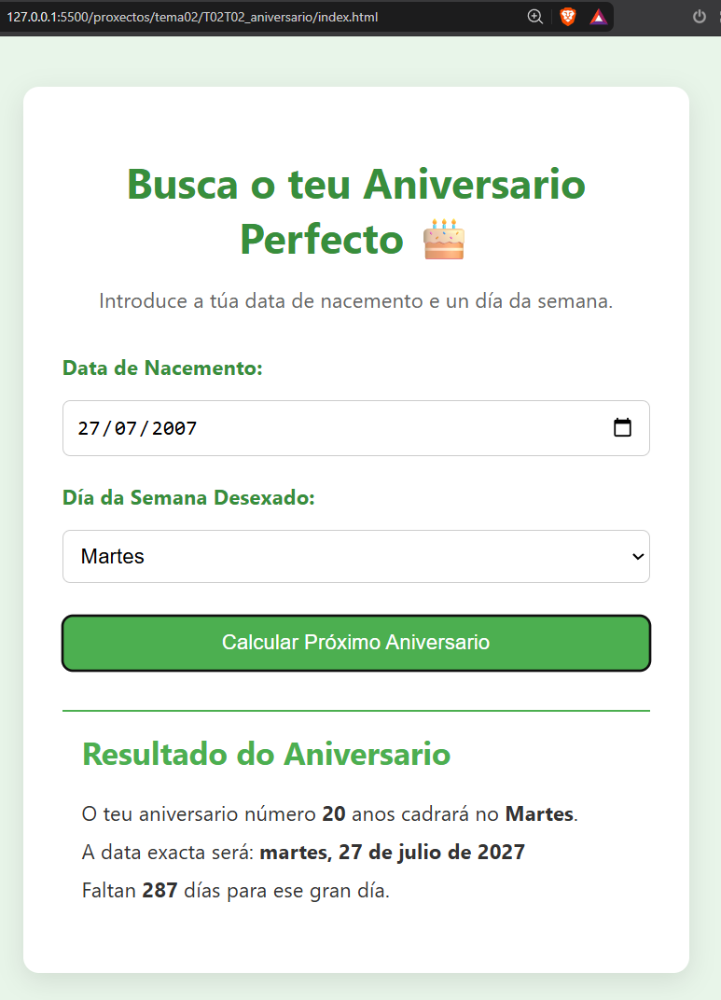

# T02T02 · Calculadora de aniversario

| Módulo | Tema | Ficheiros | Conceptos |
|---|---|---|---|
| MP0612 · DWEC | Tema 2 · Introdución a JavaScript | `index.html` · `estilos.css` · `script.js` | `Date`, `getDay()`, `while`, arrays, `Number()`, `toLocaleDateString` |



> ⚠️ O PDF orixinal ten na portada «Tarefa 01», pero é a tarefa 02 do tema.

---

## 1. Introdución e obxectivos

Constrúese unha pequena aplicación web que permite introducir unha **data de nacemento** e escoller un **día da semana**. Ao premer o botón, a aplicación busca o seguinte aniversario que coincida co día seleccionado, calcula a idade que se cumprirá e mostra a data e os días que faltan.

A práctica separa responsabilidades entre `index.html` (estrutura), `estilos.css` (presentación) e `script.js` (lóxica), e relaciona os contidos do tema 2: inserción de JavaScript, acceso ao DOM, `let` e `const`, tipos e conversións, operadores de asignación e comparación, condicionais, bucle `while`, arrays, os obxectos nativos `Date` e `Number`, funcións e formatado con `toLocaleDateString`.

**Resultados de aprendizaxe:** identificar os ficheiros dunha aplicación de cliente; explicar a xerarquía do DOM; distinguir variables, constantes, valores e asignacións; validar datos de entrada; describir o fluxo dun algoritmo con condicións e iteración; e probar a interacción desde o navegador.

## 2. Preparación da contorna

```
T02T02-Calculadora-aniversario/
├── index.html
├── estilos.css
└── script.js
```

Non se precisa servidor nin conexión externa. Comproba que os tres ficheiros están na mesma carpeta e que `src` e `href` apuntan aos nomes correctos.

> **Boa práctica:** garda os ficheiros en UTF-8 e usa as ferramentas de desenvolvemento para localizar erros de sintaxe ou referencias a elementos inexistentes.

## 3. Especificación

### 3.1. HTML5

- `lang="gl"`, codificación, `viewport`, título «Calculadora de Aniversario» e `estilos.css` no `head`.
- `div.contedor-principal` cun `h1` «Busca o teu Aniversario Perfecto 🎂», un parágrafo explicativo e un `form` con:
  - `label` + `input type="date" id="data-nacemento" required`.
  - `label` + `select id="dia-semana" required` cunha opción baleira («Selecciona un día») e os sete días. **Os `value` seguen `Date.getDay()`:** Luns = `"1"` … Sábado = `"6"`, Domingo = `"0"`.
  - `button type="button"` «Calcular Próximo Aniversario» que chama a `calcularAniversario()` con `onclick`.
- `div#resultado.resultado`, baleiro ao comezo, como destino da saída.
- `script.js` cargado ao final do `body`.

### 3.2. CSS3

- Variables en `:root`: `--cor-fondo-principal: #e8f5e9`, `--cor-primaria: #4caf50`, `--cor-secundaria: #388e3c`, `--cor-fondo-carta: #ffffff`, `--cor-sombra: rgba(0,0,0,.1)`.
- `body` con **Flexbox** para centrar a tarxeta nos dous eixes e `min-height: 100vh`.
- `.contedor-principal`: tarxeta branca, `border-radius: 12px`, sombra, `width: 90%` e `max-width: 450px`.
- `form` en columna con Flexbox e `gap: 15px`; `input[type="date"]` e `select` a ancho completo.
- Botón coa cor primaria e `:hover` coa secundaria.
- `.resultado` cun bordo superior de 2px na cor primaria e `min-height: 80px`.

### 3.3. JavaScript

- Referencias ao DOM (`data-nacemento`, `dia-semana`, `resultado`) e un array `diasGL` cos nomes dos días en galego, de Domingo a Sábado.
- `calcularAniversario()`:
  1. Le a data e o día; converte o día con `Number()`.
  2. Se falta algún dato → *«Por favor, introduce unha data de nacemento e selecciona un día.»*
  3. Se a data non é válida ou está no futuro → *«Por favor, introduce unha data válida e que non estea no futuro.»*
  4. Constrúe o aniversario do ano actual; se xa pasou, pasa ao ano seguinte.
  5. Cun bucle `while`, suma anos ata que `getDay()` coincida co día desexado.
  6. Calcula a idade que se cumprirá (resta de anos) e os días que faltan (`getTime()` e `Math.ceil`).
  7. Mostra en `#resultado` (con `innerHTML`): un `h2` «Resultado do Aniversario», o número de anos, o día da semana, a **data completa** formatada con `toLocaleDateString('gl-ES', …)` e os **días que faltan**.

## 4. Comprobación e probas

Abre `index.html`, introduce unha data pasada e escolle cada un dos días. Preme o botón e verifica que aparecen o número de aniversario, o día da semana, a data completa e os días restantes. Cambia o tamaño da xanela para comprobar que a tarxeta se adapta.

### Lista de comprobación

- [ ] `index.html`, `estilos.css` e `script.js` están na mesma carpeta.
- [ ] A data baleira mostra unha mensaxe de validación e non executa o cálculo.
- [ ] Unha data futura ou non válida mostra unha mensaxe de erro.
- [ ] Os sete valores de `dia-semana` producen un día válido.
- [ ] A consola non mostra erros de sintaxe nin referencias `undefined`.
- [ ] `.resultado` recibe o contido esperado e o deseño conserva as cores e o espazamento.

### Erros comúns

- Se non aparece ningún resultado, comproba que o `id` do HTML coincide co argumento de `getElementById`.
- Se `calcularAniversario` non existe, revisa o nome da función e a carga de `script.js`.
- Se os estilos non se aplican, comproba `href` e a carpeta.
- Se o día non coincide, lembra que `Date.getDay()` usa 0 para domingo e 6 para sábado.
- Para depurar, usa `console.log` sobre `dataNacementoStr`, `diaDesexado` e `dataProximoAniversario`, e elimínaos ao rematar.
