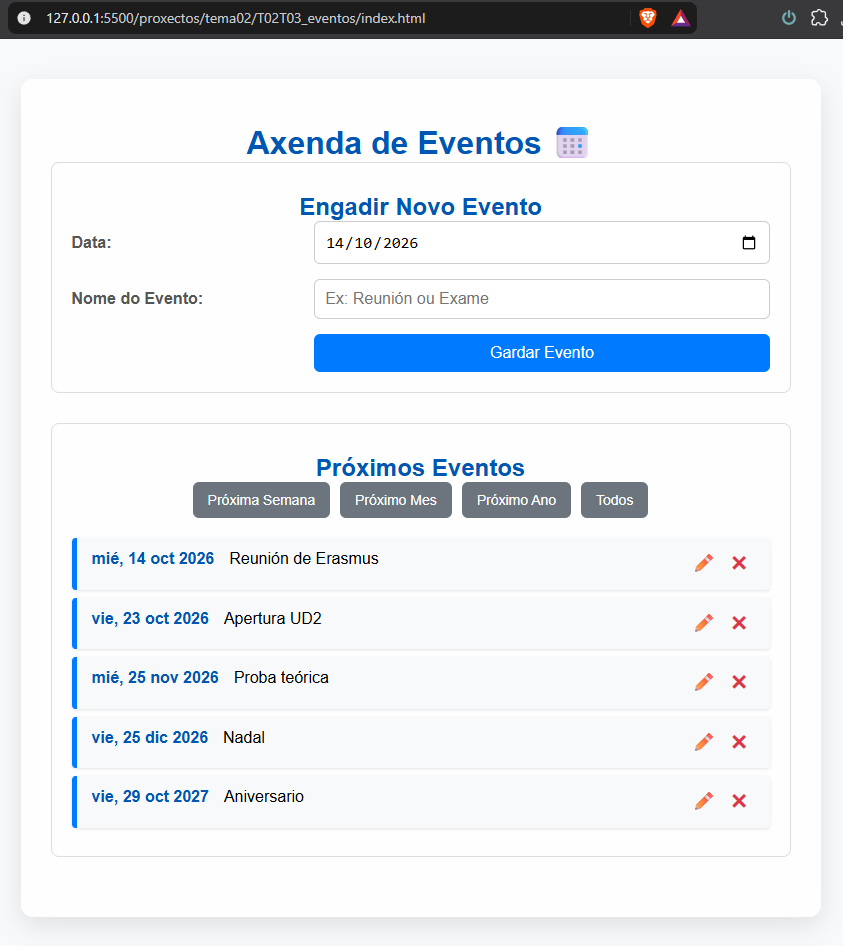

# T02T03 · Axenda de eventos

| Módulo | Tema | Ficheiros | Conceptos |
|---|---|---|---|
| MP0612 · DWEC | Tema 2 · Introdución a JavaScript | `index.html` · `estilos.css` · `script.js` | Arrays de obxectos, `filter`/`find`/`sort`, funcións frecha, `addEventListener`, `Date`, Grid + media query |



---

## 1. Introdución e obxectivos

### 1.1. Caso práctico

Constrúese unha pequena axenda de eventos no navegador. A persoa usuaria introduce unha data e un nome, garda o evento, consulta os eventos por intervalos de tempo e pode editalos ou eliminalos.

Os datos viven no array `axenda` durante a sesión e o DOM actualízase sen recargar a páxina. Non se emprega servidor, base de datos, Fetch nin almacenamento local: **ao recargar a páxina pérdense os eventos**.

### 1.2. Relación coa documentación

Inserción dun script externo con `defer`; `let`; tipos primitivos e obxectos; operadores de comparación e asignación; condicionais; funcións estándar e frecha; arrays e os métodos `filter`, `find` e `sort`; os obxectos nativos `Date` e `Number`; e o DOM mediante `getElementById`, `addEventListener` e `innerHTML`.

### 1.3. Resultados de aprendizaxe

- Identificar a responsabilidade de HTML, CSS e JavaScript nunha aplicación de cliente.
- Declarar e manipular variables, obxectos e arrays con sintaxe moderna.
- Validar datos de entrada, comparar datas e filtrar unha colección de eventos.
- Asociar eventos a controis e renderizar de novo a lista.
- Probar a aplicación e diagnosticar erros coa consola.

## 2. Preparación da contorna

```
T02T03-Axenda-eventos/
├── index.html
├── estilos.css
└── script.js
```

- Abre `index.html` no navegador ou, mellor, sérveo cun servidor local de probas (Live Server).
- A data introdúcese co control `input type="date"`; **non se admiten datas anteriores ao día actual**.

## 3. Especificación

### 3.1. HTML

- `lang="gl"`, UTF-8, `viewport`, título «Axenda de Eventos JS», `estilos.css` e `script.js` con `defer` no `head`.
- `div.contedor-principal` cun `h1` «Axenda de Eventos 📅» e dúas seccións:
  - **`div.engadir-evento`**: `h2` «Engadir Novo Evento» e un `form` con `label` + `input type="date" id="data-evento" required`, `label` + `input type="text" id="nome-evento" required` (placeholder «Ex: Reunión ou Exame») e un `button type="button"` «Gardar Evento» que chama a `engadirEvento()`.
  - **`div.lista-eventos`**: `h2` «Próximos Eventos», unha fila de catro botóns de filtro que chaman a `filtrarEventos('semana' | 'mes' | 'ano' | 'todos')` («Próxima Semana», «Próximo Mes», «Próximo Ano», «Todos») e un `ul#lista-eventos` como punto de inserción.

### 3.2. CSS3

- Reset universal e variables en `:root` (`--cor-fondo-principal`, `--cor-primaria: #007bff`, `--cor-secundaria: #0056b3`) usadas con `var(...)`.
- `.contedor-principal` con `max-width: 800px`, `padding: 30px` e `border-radius: 12px`.
- `form` con **Grid** de dúas columnas (`1fr 2fr`) e `gap: 15px`.
- Filtros e cada elemento da lista con **Flexbox** (aliñación e salto de liña).
- `.elemento-evento`: `justify-content: space-between` e `border-left: 5px solid var(--cor-primaria)`.
- Clases para os nodos xerados: `elemento-evento`, `data`, `nome`, `btn-editar`, `btn-eliminar`, con `:hover` nos botóns.
- `@media (max-width: 600px)`: o formulario pasa a **unha soa columna**.

### 3.3. JavaScript

- Referencias a `data-evento`, `nome-evento` e `lista-eventos`, e o array `axenda`. Cada evento é un obxecto `{ id, data, dataObj, nome }`; o `id` créase con `Number(Date.now())`.
- **Tecla Enter:** un `addEventListener('keypress', …)` cunha función frecha no campo do nome chama a `engadirEvento()`.
- **`formatarData(data)`:** devolve a data con `toLocaleDateString('gl-ES', { weekday: 'short', year: 'numeric', month: 'short', day: 'numeric' })`.
- **`engadirEvento()`:**
  - Le os valores (o nome con `trim()`).
  - Data baleira → `alert("Data vacía")`; nome baleiro → `alert("Nome evento vacío")`.
  - Crea a data **á medianoite** (`dataStr + 'T00:00:00'`) e compárase con `hoxe` tamén normalizado a medianoite. Se é pasada → `alert("Non se poden engadir eventos con data pasada.")`.
  - `push` ao array, limpa o nome, renderiza e devolve o foco.
- **`eliminarEvento(id)`:** `filter` para crear un array sen ese `id`, e renderiza.
- **`editarEvento(id)`:** `find` do evento, carga os seus valores no formulario e elimina a versión antiga (editar = cargar, borrar e volver gardar).
- **`filtrarEventos(rango)`:** calcula unha data límite desde hoxe (+7 días, +1 mes, +1 ano ou +100 anos para «todos») e mostra os eventos con `hoxe ≤ data ≤ límite` (intervalo inclusivo).
- **`renderizarEventos(lista)`:** ordena por data con `sort((a, b) => a.dataObj - b.dataObj)`, constrúe cun `for` un `li.elemento-evento` por evento (data formatada, nome e botóns ✏️ / ✖ que chaman a `editarEvento(id)` / `eliminarEvento(id)`) e asígnao con `innerHTML`.

> **Seguridade:** nesta solución didáctica o nome insírese sen escapar. Nunha aplicación real deberíase usar `textContent` ou escapar a entrada para evitar a inxección de marcado.

## 4. Comprobación e probas

### 4.1. Procedemento

- [ ] Ao abrir a páxina aparece a axenda baleira sen erros na consola.
- [ ] Premer «Gardar Evento» cos campos baleiros mostra «Data vacía» ou «Nome evento vacío».
- [ ] Unha data anterior á actual rexéitase.
- [ ] Unha data válida e un nome engaden un elemento ordenado e baleiran o nome.
- [ ] Con eventos en datas diferentes, os filtros Próxima Semana, Próximo Mes, Próximo Ano e Todos mostran o que corresponde.
- [ ] Editar carga os datos; ao gardar de novo, o evento queda modificado.
- [ ] Eliminar fai desaparecer o evento.
- [ ] Por debaixo de 600 px o formulario aparece nunha columna.
- [ ] Ao recargar, a axenda queda baleira (non hai persistencia).

### 4.2. Erros comúns

- Se `getElementById` devolve `null`, revisa os `id` e confirma que `script.js` se carga con `defer`.
- Se a data aparece un día antes, mantén a construción `dataStr + 'T00:00:00'` e a normalización de `hoxe`.
- Se editar dá un erro, comproba que o `id` é `Number` e que `find` atopou o evento.
- Os filtros só seleccionan eventos **desde hoxe** ata o límite calculado.
- Que os eventos desaparezan ao recargar non é un fallo do DOM: a axenda só se garda en memoria.
- Para depurar, usa `console.log` sobre `axenda`, `rango` e `eventosFiltrados`.

### 4.3. Melloras posteriores

`localStorage`, delegación de eventos e creación segura de nodos con `textContent`.
