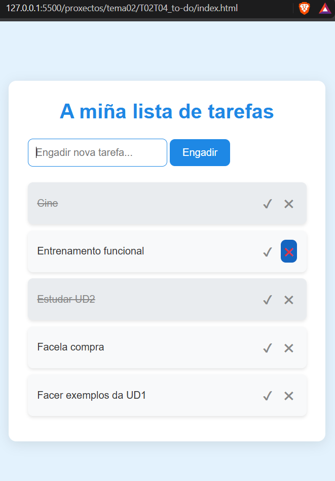

# T02T04 · Lista To-Do

| Módulo | Tema | Ficheiros | Conceptos |
|---|---|---|---|
| MP0612 · DWEC | Tema 2 · Introdución a JavaScript | `index.html` · `estilos.css` · `script.js` | Estado nun array, `push`/`sort`/`splice`, `localeCompare`, eventos de clic e teclado |



---

## 1. Introdución e obxectivos

### 1.1. Caso práctico

Constrúese unha aplicación para xestionar unha lista de tarefas. A persoa usuaria escribe unha descrición, preme **«Engadir»** ou a tecla **Enter** e ve a nova tarefa **ordenada alfabeticamente**. Cada elemento pode marcarse como completado co símbolo ✔ ou eliminarse co símbolo ✖.

`index.html` define a estrutura e o DOM; `estilos.css`, a presentación; e `script.js` mantén os datos, renderiza a lista e responde aos eventos.

### 1.2. Resultado esperado

Ao abrir `index.html` aparece un panel centrado cun campo de entrada, un botón e unha lista baleira. Ao engadir un texto non baleiro créase un obxecto con `id`, `texto` e `completada`; a lista actualízase, queda ordenada con `localeCompare()` e o foco volve ao campo.

### 1.3. Resultados de aprendizaxe

- Relacionar elementos HTML, estilos CSS e nodos do DOM.
- Seleccionar elementos con `getElementById()` e modificar o seu contido con `innerHTML`.
- Representar o estado dunha interface con arrays e obxectos.
- Usar funcións, condicións, bucles e os métodos `push()`, `sort()` e `splice()`.
- Xestionar eventos de clic e de teclado e comprobar os estados con probas reproducibles.

## 2. Preparación da contorna

```
T02T04-Lista-To-Do/
├── index.html
├── estilos.css    # enlazada desde o head
└── script.js      # cargado con defer
```

Non fan falla bibliotecas externas, base de datos nin rede. Os símbolos ✔ e ✖ úsanse nos botóns de completar e eliminar.

## 3. Especificación

### 3.1. HTML

- HTML5 con `lang="gl"`, `charset="UTF-8"` e `viewport`; `estilos.css` con `link` e `script.js` con `defer` no `head`.
- `div.contedor-principal` con:
  - `h1` «A miña lista de tarefas».
  - `div.formulario-tarefa` con `input type="text" id="entrada-tarefa"` (placeholder «Engadir nova tarefa...») e un `button type="button"` «Engadir» que chama a `engadirTarefa()`.
  - `ul#lista-tarefas`, onde se xeran os `li`.
- Cada fila xerada é un `li.elemento-tarefa` (máis a clase `completada` se o está) cun `span` para o texto e un `div.contedor-btns` cos botóns `.btn-completar` (✔) e `.btn-eliminar` (✖).

### 3.2. CSS3

- Reset universal (`margin`, `padding` e `box-sizing: border-box`).
- Variables en `:root`: `--cor-fondo: #e3f2fd`, `--cor-principal: #1e88e5`, `--cor-texto: #333`, `--cor-borde-input: #b3e5fc`, `--cor-sombra: rgba(0,0,0,.1)`.
- `body` con **Flexbox** para centrar o panel nos dous eixes e `min-height: 100vh`.
- Contedor con `width: 90%` e `max-width: 500px`.
- `.elemento-tarefa` con Flexbox e `justify-content: space-between`.
- Estado completado: `.elemento-tarefa.completada span` con `text-decoration: line-through`, cor `#888` e outro fondo.
- `:focus` no campo; `:hover` en `.btn-completar` (verde `#28a745`) e `.btn-eliminar` (vermello `#dc3545`).

### 3.3. JavaScript

- Referencias a `entrada-tarefa` e `lista-tarefas`, e o array de estado `tarefas`.
- `keypress` no campo: se `tecla.key === 'Enter'` → `engadirTarefa()`.
- **`engadirTarefa()`:** `value.trim()`; se non está baleiro, fai `push` de `{ id: Date.now(), texto, completada: false }`, ordena con `sort((a, b) => a.texto.localeCompare(b.texto))`, renderiza e baleira o campo.
- **`renderizarTarefas()`:** percorre o array cun `for`, constrúe o HTML de cada fila (os botóns usan `onclick` co índice `i`), asígnao con `innerHTML` e devolve o foco ao campo.
- **`completarTarefa(indice)`:** se existe a posición, inverte `completada` con `!` e renderiza.
- **`eliminarTarefa(indice)`:** se existe a posición, `splice(indice, 1)` e renderiza.

> **Nota da guía:** a variable `formularioTarefa` declárase pero non se usa (e ademais busca un `id` que non existe, polo que vale `null`). Pódese eliminar.
>
> A solución non usa LocalStorage, Fetch, WebSockets nin clases: as tarefas pérdense ao recargar.

## 4. Comprobación e probas

1. Carga a páxina e confirma que o campo está enfocado e a lista baleira.
2. Escribe «Comprar pan» e preme «Engadir»: aparece unha fila con ✔ e ✖.
3. Engade «Estudar JavaScript» e outra tarefa; comproba a orde alfabética.
4. Preme ✔: a fila adopta a clase `completada`, o texto aparece riscado e cambia o fondo. Preme de novo para desfacelo.
5. Preme ✖: a tarefa desaparece e as restantes conservan a orde.
6. Preme Enter cun texto válido: o resultado é o mesmo que co botón.
7. Preme «Engadir» co campo baleiro ou só con espazos: non aparece ningunha fila nova.

### 4.1. Lista de comprobación

- [ ] `index.html` enlaza correctamente `estilos.css` e `script.js`.
- [ ] Os `id` `entrada-tarefa` e `lista-tarefas` coinciden entre HTML e JavaScript.
- [ ] A lista renderízase tras engadir, completar e eliminar.
- [ ] A interface é lexible en xanelas estreitas grazas a `width: 90%` e `max-width`.
- [ ] A consola non mostra erros durante as probas.

### 4.2. Diagnóstico

- Sen estilos: comproba a ruta relativa e o nome exacto de `estilos.css`.
- O botón non responde: revisa que `engadirTarefa()` estea definida e que `script.js` se cargue.
- Lista baleira despois de escribir: inspecciona `textoTarefa`, o resultado de `trim()` e a condición `textoTarefa !== ''`.
- Pon puntos de interrupción en `engadirTarefa()` e `renderizarTarefas()` e consulta `tarefas` antes e despois de cada operación.
