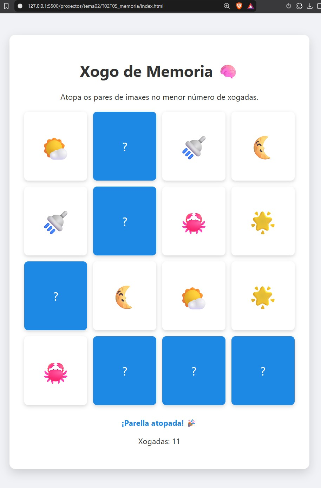

# T02T05 · Xogo de memoria

| Módulo | Tema | Ficheiros | Conceptos |
|---|---|---|---|
| MP0612 · DWEC | Tema 2 · Introdución a JavaScript | `index.html` · `estilo.css` · `memoria.js` | Array de obxectos, operador de propagación, Fisher-Yates, `setTimeout`, CSS Grid |



> ⚠️ Atención aos nomes: nesta tarefa a folla é **`estilo.css`** (sen *s*) e o script é **`memoria.js`**.

---

## 1. Introdución e obxectivos

### 1.1. Caso práctico

O «Xogo de Memoria» de parellas: un taboleiro de **16 cartas con oito parellas de emoticonas**. O usuario preme dúas cartas, o programa comproba se coinciden, conta as xogadas e avisa cando se completan todas as parellas.

### 1.2. Conceptos aplicados

- Estrutura HTML5, atributos `id` e `class` e xerarquía do DOM.
- Folla de estilos externa.
- `let`, arrays, obxectos literais, **operador de propagación** e funcións.
- `while` e `for`, `if`, comparación estrita, `Math.random()` e `Math.floor()`.
- DOM con `getElementById()`, `innerHTML` e `innerText`.
- Temporización con `setTimeout()` e control do fluxo de interacción.

O script carga con `defer`, así que o DOM xa está dispoñible cando se executa.

### 1.3. Resultado esperado

Abrir a páxina, ver 16 cartas mesturadas, virar dúas, recibir unha mensaxe de acerto ou erro, consultar o contador de xogadas e completar o xogo. Saber inspeccionar o DOM e a consola para localizar erros.

### 1.4. Resultados de aprendizaxe

- Identificar a función dos elementos HTML e dos selectores CSS empregados.
- Describir o estado dunha carta mediante `virada`, `atopada` e `emoticono`.
- Explicar o algoritmo de mestura e a súa aplicación ao array de emoticonas.
- Relacionar cada acción co fluxo `voltearCarta()` → `comprobarParella()` → `renderizarTaboleiro()`.
- Verificar o xogo e rexistrar limitacións ou melloras posibles.

## 2. Preparación da contorna

```
T02T05-Xogo-memoria/
├── index.html   # punto de entrada
├── estilo.css   # variables de cor, Grid e estilos das cartas
└── memoria.js   # lóxica do xogo
```

Abre `index.html` nun navegador ou sérveo con Live Server.

## 3. Especificación

### 3.1. HTML5

- `lang="gl"`, UTF-8, `viewport`, título «Xogo de Memoria»; `estilo.css` e `memoria.js` (con `defer`) no `head`.
- `div.contedor-xogo` con:
  - `h1` «Xogo de Memoria 🧠» e o parágrafo «Atopa os pares de imaxes no menor número de xogadas.»
  - `div.taboleiro#taboleiro`, baleiro (JavaScript insire nel as 16 cartas).
  - `div.info-xogo` con `p#mensaxe` e `p#contador-xogadas` («Xogadas: 0»).

### 3.2. CSS3

- Variables en `:root`: `--cor-fondo-principal: #f0f2f5`, `--cor-tapa-carta: #1e88e5`, `--cor-fondo-carta: #ffffff`, `--cor-sombra: rgba(0,0,0,.15)`.
- `body` con **Flexbox** para centrar; contedor con `width: 90%` e `max-width: 550px`.
- `.taboleiro` con **Grid** de 4 columnas iguais (`repeat(4, 1fr)`) e `gap: 12px` → grella 4 × 4.
- `.carta` con `position: relative` e `height: 140px`; as súas dúas caras (`.parte-diante` e `.parte-detras`) van con `position: absolute`, ocupan o 100 % e centran o contido con Flexbox.
- Tapa (`.parte-diante`) con `opacity: 1` e a cor da tapa; cara (`.parte-detras`) con `opacity: 0` e `pointer-events: none`.
- `.carta-virada` inverte as opacidades. **Sen `transform` nin `transition`:** o volteo é instantáneo.
- `.parella-atopada` cambia o cursor para indicar que xa non se pode premer.

> Mellora opcional: unha media query que reduza a altura das cartas, ou `repeat(4, minmax(0, 1fr))`, para pantallas moi estreitas.

### 3.3. JavaScript

**Estado:**

- Referencias a `taboleiro`, `mensaxe` e `contador-xogadas`.
- `emoticonosBase`: array con 8 emoticonas (🌟 🌜 🌤️ ⛈️ 🏀 🚿 🥗 🦀); `emoticonos = [...emoticonosBase, ...emoticonosBase]` → 16.
- `estadoTaboleiro`: array de obxectos `{ virada, atopada, emoticono }`.
- `cartasViradas` (índices da quenda), `bloqueoTaboleiro` (bandeira), `paresAtopados` e `xogadas`.

**Funcións:**

- **`embarallarArray(array)`:** algoritmo de Fisher-Yates cun `while` desde o último índice (intercambio cunha posición aleatoria `0..índice`). Devolve o mesmo array.
  > Segundo a guía, non fai falla memorizar o algoritmo: se saíse nunha proba práctica, daríase no enunciado.
- **`iniciarXogo()`:** mestura, crea o estado inicial boca abaixo cun `for` e renderiza.
- **`renderizarTaboleiro()`:** para cada carta xera `div.carta` (+ `carta-virada` / `parella-atopada` segundo o estado) con `onclick="voltearCarta(i)"`, que contén `div.contido-carta` > `.parte-diante` («?») e `.parte-detras` (emoticona). Asígnao con `innerHTML`.
- **`voltearCarta(indice)`:** saída temperá se o taboleiro está bloqueado ou a carta xa está virada ou atopada. Se non, vírase, garda o índice e renderiza. Ao chegar a dúas cartas: bloquea, incrementa `xogadas`, actualiza o contador e programa `comprobarParella` con `setTimeout(…, 900)`.
- **`comprobarParella()`:** se as dúas emoticonas son iguais (`===`), marca ambas como atopadas, suma un par e mostra «¡Parella atopada! 🎉». Ao completar os 8 pares mostra «¡Xogo completado en N xogadas! 🏆». Se non coinciden, volve tapalas e mostra «Tenta de novo...». Ao final baleira `cartasViradas`, desbloquea e renderiza.
- Chamada final a `iniciarXogo()`.

## 4. Comprobación e probas

### 4.1. Procedemento

- Os tres ficheiros teñen os nomes exactos e están na mesma carpeta.
- Aparecen 16 cartas nunha grella 4 × 4, o contador comeza en 0 e non hai erros na consola.
- Ao premer unha carta vese a súa emoticona e o contador aínda non aumenta.
- Ao premer a segunda, o contador pasa a 1 e o taboleiro ignora as pulsacións durante uns 900 ms.
- Se non son iguais, tápanse de novo e aparece «Tenta de novo...». Se son iguais, quedan visibles e aparece «Parella atopada!».
- Ao atopar as oito parellas aparece a mensaxe final.
- O xogo vese ben en escritorio e nunha xanela estreita.

### 4.2. Checklist

- [ ] O documento HTML declara `lang="gl"` e UTF-8.
- [ ] `estilo.css` cárgase sen erro 404.
- [ ] `memoria.js` cárgase con `defer` e inicia o xogo.
- [ ] O taboleiro contén 16 cartas e oito valores duplicados.
- [ ] As cartas válidas pódense virar e as atopadas non se poden volver seleccionar.
- [ ] O bloqueo impide seleccionar tres cartas na mesma quenda.
- [ ] O contador aumenta unha vez por cada parella de seleccións.
- [ ] A mensaxe diferencia acerto, erro e fin.
- [ ] Non hai desbordamento grave no ancho probado.

### 4.3. Erros comúns

- Non aparece o taboleiro → consola e `id="taboleiro"`.
- `ReferenceError: voltearCarta is not defined` → `memoria.js` non se cargou ou cambiouse o nome da función.
- Pódense virar tres cartas → `bloqueoTaboleiro` debe pasar a `true` cando `cartasViradas` chega a dúas.
- O taboleiro duplícase ao reiniciar → `iniciarXogo()` fai `push` sen baleirar: habería que reiniciar `estadoTaboleiro = []` e `cartasViradas = []`.

> ⚠️ **Discrepancia no PDF orixinal:** a conclusión da guía di que «os materiais non conteñen unha Lista To-Do, senón un Xogo de Memoria». É un texto arrastrado da revisión da tarefa; o enunciado correcto é o Xogo de Memoria (a Lista To-Do é a [T02T04](../T02T04-Lista-To-Do/)).
