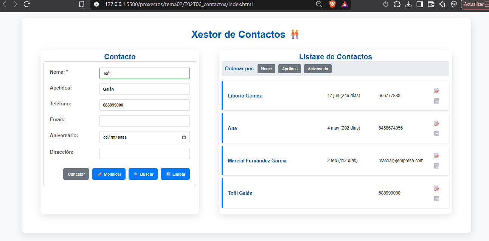

# T02T06 · Xestor de contactos

| Módulo | Tema | Ficheiros | Conceptos |
|---|---|---|---|
| MP0612 · DWEC | Tema 2 · Introdución a JavaScript | `index.html` · `estilos.css` · `script.js` | CRUD nun array, `find`/`findIndex`/`filter`/`sort`, `localeCompare`, spread, `Date`, Grid + Flexbox + media query |



---

## 1. Introdución e obxectivos

### 1.1. Caso práctico

Un xestor de contactos que funciona integramente no navegador. Permite introducir os datos dunha persoa, **crear** e **modificar** rexistros, **buscar** por nome ou apelidos, **ordenar** a listaxe e **eliminar** contactos. O estado gárdase nun array de JavaScript durante a sesión.

### 1.2. Conceptos aplicados

- Estrutura HTML5 e relación entre formularios, controis e a lista do DOM.
- CSS3 con variables, Flexbox, Grid, pseudoclases de validación e unha media query.
- JavaScript no navegador: selección de elementos, obxectos, arrays, funcións, eventos e `innerHTML`.
- Métodos de arrays (`push`, `filter`, `find`, `findIndex`, `sort`) e `localeCompare`.
- Obxectos `Date` para calcular o próximo aniversario e os días que faltan.

### 1.3. Resultados de aprendizaxe

- Identificar e explicar a xerarquía do DOM da aplicación.
- Relacionar cada regra CSS coa maquetación e a experiencia de uso.
- Describir o fluxo CRUD e o estado gardado en `axenda`.
- Probar os casos válidos e os erros previsibles coas ferramentas de desenvolvemento.

## 2. Preparación da contorna

```
T02T06-Xestor-contactos/
├── index.html    # link a estilos.css e script ao final do body
├── estilos.css
└── script.js
```

Non fai falla instalar nada nin un servidor. Abre a consola (F12) antes de probar.

## 3. Especificación

### 3.1. HTML5

- `lang="gl"`, UTF-8, `viewport`, título «Axenda de Contactos», `estilos.css` no `head` e `script.js` **ao final do `body`**.
- `body` → `div.contedor-principal` (`h1` «Xestor de Contactos 🧑‍🤝‍🧑») → `div.contedor-datos` → dous `div.contedor`:
  1. **Contacto:** `h2` e `form#formulario-contacto` con pares `label`/`input`:
     - `nome` (texto, **único `required`**, etiqueta «Nome: \*»), `apelidos` (texto), `telefono` (`tel`), `email` (`email`), `data-aniversario` (`date`), `direccion` (texto).
     - `input type="hidden" id="contacto-id-oculto"`: distingue entre crear e modificar.
     - `div.contedor-btns` con catro `button type="button"`: `#btn-crear` («💾 Crear» → `xestionarContacto('crear')`), `#btn-modificar` («✏️ Modificar» → `xestionarContacto('modificar')`, **desactivado ao comezo**), `#btn-buscar` («🔍 Buscar» → `xestionarContacto('buscar')`) e `#btn-limpar` («🔄 Limpar» → `limparFormulario()`).
  2. **Listaxe de Contactos:** `h2`, `div.opcions-ordenacion` («Ordenar por:» + botóns Nome / Apelidos / Aniversario → `ordenarContactos('nome' | 'apelidos' | 'aniversario')`) e `ul#lista-contactos` baleira.

### 3.2. CSS3

- Reset universal e variables en `:root` (`--cor-fondo-principal: #f8f9fa`, `--cor-primaria: #007bff`, `--cor-secundaria: #0056b3`, `--cor-fondo-claro: #fff`, `--cor-sombra`).
- `.contedor-principal`: tarxeta branca centrada (`width: 90%`, `margin: 20px auto`).
- `.contedor-datos` con **Flexbox** e `flex-wrap: wrap`; cada `.contedor` con `flex-grow: 1`, sombra e bordos redondeados.
- `form` con **Grid** de dúas columnas (`1fr 2fr`) e `gap: 15px`; os inputs a ancho completo.
- Validación visual: `input:required:invalid` (bordo vermello `#dc3545` e sombra) e `input:required:valid` (bordo verde `#28a745`).
- `.contedor-btns` ocupa toda a fila (`grid-column: 1 / -1`), con Flexbox aliñado á dereita. Os botóns teñen transición, desprazamento en `:hover`/`:active` e un estilo para `:disabled` (gris, `not-allowed`).
- `.opcions-ordenacion` con Flexbox e fondo gris claro.
- `.contacto-item` con **Grid** `2fr 1fr 1fr 50px` (nome, aniversario, teléfono/email, accións), bordo esquerdo de cor primaria e sombra.
- `.btns-accion` con botóns sen fondo, `.btn-editar` amarelo e `.btn-eliminar` vermello, con `scale` en `:hover`.
- `@media (max-width: 600px)`: o formulario pasa a unha columna (Flexbox en columna).

### 3.3. JavaScript

- Referencias a todos os campos, ao formulario, á lista e aos botóns Crear e Modificar. `axenda` é un array de obxectos `{ id, nome, apelidos, telefono, email, dataAniversario, direccion }`; os `id` novos créanse con `Date.now()`.
- **Axudas:**
  - `obterProximoAniversario(dataAniversario)`: a partir de `AAAA-MM-DD`, devolve o aniversario deste ano ou, se xa pasou, o do seguinte.
  - `calcularDiasFaltan(dataFutura)`: días desde hoxe (á medianoite), redondeando cara arriba.
  - `limparFormulario()`: `reset()` do formulario, baleira o id oculto e restaura os botóns (Crear activo co texto «💾 Crear», Modificar desactivado).
- **CRUD — `xestionarContacto(accion)`:**
  - O nome é obrigatorio → `alert("O nome é un campo obrigatorio.")`.
  - `crear` (sen id oculto): `push` e `alert("Contacto creado con éxito!")`.
  - `modificar` (con id oculto): `findIndex` e substitución; `alert("Contacto modificado con éxito!")`.
  - `buscar`: `filter` dos contactos cuxo nome **ou** apelidos inclúen o texto escrito no campo nome (sen distinguir maiúsculas). **Non** limpa o formulario.
  - Despois de crear ou modificar: limpa o formulario e renderiza.
- **`cargarContactoParaEditar(id)`:** `find` do contacto, carga os campos e o id oculto, desactiva Crear (o seu texto pasa a «Cancelar») e activa Modificar.
- **`eliminarContacto(id)`:** `confirm(...)` e, se se acepta, `filter` sen ese id, renderiza e limpa.
- **`ordenarContactos(criterio)`:** traballa sobre unha **copia** (`[...axenda]`) para non alterar a orde gardada. Para `apelidos` ou `aniversario` descarta antes os contactos sen ese dato. Ordena con `localeCompare(…, 'gl')` ou polos días que faltan ao próximo aniversario.
- **`renderizarContactos(lista)`:** se está baleira, mostra «Non hai contactos nesta axenda.»; se non, un `li.contacto-item` por contacto: nome + apelidos, aniversario (`toLocaleDateString('gl-ES', { month: 'short', day: 'numeric' })` + «(N días)»), teléfono ou email ou «N/A», e os botóns 📝 (`cargarContactoParaEditar`) e 🗑️ (`eliminarContacto`).
- Ao cargar: `renderizarContactos(axenda)`.

> **Seguridade:** úsase `innerHTML` porque forma parte do código proporcionado. Con datos de usuarios reais sería preferible crear nodos e usar `textContent`.

## 4. Comprobación e probas

1. Ao abrir aparecen o formulario e a mensaxe de axenda baleira.
2. «Crear» sen nome → alerta de campo obrigatorio.
3. Nome e datos opcionais + Crear → o contacto aparece na listaxe.
4. Con varios contactos, proba as tres ordenacións.
5. Edita un contacto, cambia un dato e preme Modificar.
6. Escribe un nome ou apelido e preme Buscar; despois Limpar para volver á listaxe completa.
7. Eliminar pide confirmación.
8. Por debaixo de 600 px o formulario móstrase nunha columna.
9. Na consola (F12) non hai erros vermellos.

### Lista de comprobación

- [ ] Os tres ficheiros están na mesma carpeta.
- [ ] O nome é obrigatorio e valídase correctamente.
- [ ] Crear, buscar, modificar e eliminar funcionan.
- [ ] A axenda baleira mostra a mensaxe prevista.
- [ ] As tres ordenacións producen a orde esperada.
- [ ] O deseño adáptase a pantallas pequenas.
- [ ] Non hai erros na consola.

### Erros comúns

- Sen estilos → revisa a ruta e o nome de `estilos.css`.
- Erro de elemento `null` → comproba os `id` e que `script.js` se carga despois do marcado.
- Modificar non funciona → verifica que `idOcultoInput` ten valor e que o contacto segue en `axenda`.
- Un aniversario non se ordena → a data debe estar no formato `AAAA-MM-DD`.
- A busca non devolve resultados → só examina nome e apelidos.
